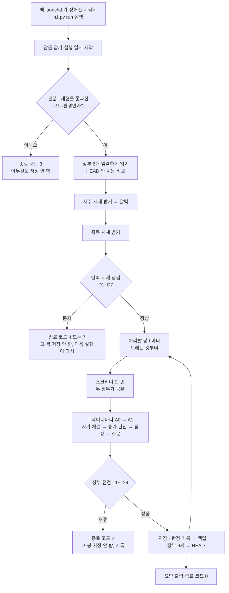

# 01. 무엇을 만들었나 — H1 포워드 모의매매

> 한 줄: **"트레이너가 주식을 안 산 돈(쉬는 돈)을 현금으로 두지 말고 지수에 넣어 두면 낫다"(H1)** 는 가설을, 진짜 돈 없이 **매일 실제 시세로** 3개월 동안 확인하는 장부 시스템이다.

---

## 1. 왜 만들었나

### 1.1 앞선 연구에서 나온 것
- 이 프로그램에는 세 트레이너(마라토너·스프린터·파이오니어)가 있다. 각자 규칙대로 주식을 사고판다.
- 연구 R0 에서 세 트레이너는 지수(SPY·KOSPI 200)를 그냥 들고 있는 것보다 못했다. 이유는 **기간 대부분 돈이 현금으로 놀고 있었기** 때문이다.
- 연구 R2(2015~2026 과거 시세로 돌린 백테스트)에서 **H1 "쉬는 돈을 지수에"** 가 채택 후보가 됐다.

| 종목군 | A0 지금 방식(쉬는 돈=현금) | A1 쉬는 돈=지수 | 지수 그냥 들고 있기 |
|---|---:|---:|---:|
| 미국 20종목(R0) | +239.8% | +494.8% | SPY +262.9% |
| 미국 2014년 말 상위 20 | +38.0% | +143.9% | SPY +262.9% |
| 국내 32종목 | +182.2% | +343.5% | KS200 +262.6% |

- 세 종목군 모두 A1 이 A0 보다 크게 나았다. 다만 시장을 이긴다는 근거는 아니다(생존편향을 줄인 종목군에서는 지수에 진다).
- 트레이너가 잘한다는 근거도 아니다. 트레이너 매매를 "시작일만 무작위로 바꾼 매매 1,000번"과 견주면 미국 두 종목군에서 백분위 12%·16%(무작위보다 못함), 국내 88%(95% 기준에 못 미침)였다. H1 은 쉬는 돈을 둘 곳만 바꾼 것이다.
- 하락장(R2 의 2018·2022)에서는 A1 이 A0 보다 뒤처졌다(현금 방석이 없음). 그래서 3개월 포워드의 A1−A0 는 대부분 "그동안 시장이 올랐나 내렸나"로 정해지고, 수익률은 기록만 한다.
- R2 는 팀장(claude)을 끄고 돌렸다. 포워드는 팀장을 켜지만, 두 장부가 같은 판정을 쓰므로 A1−A0 비교에는 영향이 없다.

### 1.2 그래서 무엇을 확인하나
- 백테스트는 "과거 자료 + 연구용 시뮬레이터"다. 실제 운영(매일 시세 받기, 맥이 꺼짐, 시세가 늦음, 팀장(LLM) 판정)에서도 **장부가 틀리지 않고 매일 돌아가는지**는 따로 확인해야 한다.
- 그래서 같은 날·같은 돈으로 두 장부를 나란히 돌린다.
  - **A0**: 쉬는 돈을 현금으로(비교용 그림자 장부)
  - **A1**: 쉬는 돈을 지수로(H1)
- **판정은 수익률이 아니라 운영 기준**으로 한다(3개월은 수익률로 판단하기에 너무 짧다). 판정 기준은 결과를 보기 전에 문서로 고정했다(사전 등록).

---

## 2. 무엇을 만들었나 (한눈에)

| 무엇 | 내용 |
|---|---|
| 장부 | 시장(미국·국내) × 장부(A0·A1) × 트레이너 3명 = **시장마다 6개**. `state/h1/<시장>/<A0\|A1>/team_<트레이너>.json` |
| 시작 금액 | 미국 $100,000, 국내 ₩100,000,000. 트레이너 몫 60/30/10% |
| 쉬는 돈을 넣는 곳 | 미국 SPY, 국내 KOSPI 200 가격지수(KS200). 소수 단위로 산다 |
| 매일 실행 | `python h1.py run --market us\|kr` 한 번에 두 장부가 같은 날을 처리 |
| 팀장 판정 | `claude -p` 로 받은 판정을 **기록 파일에 먼저 적고** 두 장부가 같은 판정을 쓴다 |
| 점검 | 매 봉 저장 전에 장부 규칙 24가지(L1~L24) 점검, 시세 문제 7가지(D1~D7) 점검 |
| 보고서 | `python h1_report.py --market us\|kr` 월간 보고서, `--final` 최종 판정 |
| 진짜 돈·주문 | **없음**. 증권사 주문 코드와 완전히 분리 |

---

## 3. 어떻게 작동하나

### 3.1 하루 흐름



### 3.2 한 봉 안에서 A1 이 하는 일 (같은 시가에)
1. 어제 낸 **매도** 주문을 오늘 시가로 판다.
2. 어제 낸 **매수** 주문을 산다. 현금이 모자라면 **모자란 만큼만** 지수를 판다.
3. 남은 현금이 1(달러·원) 이상이면 전부 지수로 산다(쓸어 담기).
4. 장 마감 값으로 보유 종목을 평가하고, 팔 신호가 나면 내일 시가 매도 주문.
5. 새 후보를 팀장에게 묻고, 통과한 것을 내일 시가 매수 주문.

A0 는 같은 순서에서 2의 "지수 팔기"와 3의 "쓸어 담기"가 없다(쉬는 돈은 현금).

### 3.3 시작 규칙
- 시작 날(S)은 **입금만** 한다. 장 마감 값으로 첫 판단만 한다.
- 다음 날(S+1) 시가에 A1 은 현금 전부를 먼저 지수로 바꾸고, 그다음 그날 주문을 처리한다.

### 3.4 판정 (사전 등록)
- 판정 창 = 시작 날부터 63거래일(S ~ S+62). 시장마다 따로.
- 통과 조건(모두):
  1. 장부 논리 오류 0건
  2. 빠진 날 0, 늦게 처리한 날 창 전체 10일 이하, 한 번에 따라잡은 날 5일 이하
  3. 재현(R2 와 같은 숫자가 나오는지)을 통과한 코드·환경으로만 돌았다
- 재시작은 정해진 이유로만, 최대 2번, 마감 2027-06-30.
- 수익률은 기록만 하고 판정에 쓰지 않는다.

---

## 4. 파일 지도

| 파일 | 줄 수(대략) | 하는 일 |
|---|---:|---|
| `h1.py` | 4,000 | H1 의 중심. 엔진(한 봉 처리) + 실행기(start·run·restart·corp-action·amend-rules·status) |
| `h1_check.py` | 900 | 장부 점검 L1~L24. 인터넷·파일 쓰기 없는 순수 함수 |
| `h1_report.py` | 2,000 | 월간·최종 보고서, 금리·이자, 지수 들고 있기 비교 |
| `team.py` | 380 | 운영 팀장 루프. H1 갈고리 5곳만 더했다(H1 이 아니면 동작이 바이트까지 그대로) |
| `paper_wallet.py` | 180 | 가짜 지갑. 소수 단위 보유, 매도세 인자 |
| `analyst.py` | 230 | 팀장(`claude -p`) 다리. 판정 기록용 `analyze_logged` 더함 |
| `screener.py` | 150 | 매수 후보 찾기. 날짜로 자르는 `scan_frames` 더함 |
| `tests/` | — | H1 시험 8개 파일 + 골든(`tests/golden/`) |
| `requirements-h1.txt` | — | 맥 H1 전용 환경의 정확한 라이브러리 버전 |
| `docs/h1-forward-design.md` | 1,300 | 설계(3판). 모든 규칙의 원본 |
| `docs/h1-review-*.md` | — | 독립 검토 기록(설계 2회, 구현 4회) |

---

## 5. 명령과 종료 코드

```
python h1.py start   --market us|kr      # 판정 창 시작(시장마다 한 번)
python h1.py run     --market us|kr      # 매일
python h1.py status  --market us|kr      # 지금 상태
python h1.py restart --market m --confirm m --reason L      # 사유는 L·backlog·rule-change 중 하나, 바로 실행·되돌릴 수 없음
python h1.py corp-action --market m --code X --split 2 --date D --source URL       # 주식 분할
python h1.py corp-action --market m --code X --delist --confirm X --last-date D --source URL   # 상장폐지
python h1.py corp-action --market m --code X --accept-correction --source URL      # 시세 정정 확정
python h1.py amend-rules --market kr --source URL                                  # 국내 세율 표 줄 추가
python h1_report.py --market us|kr [--month YYYY-MM] [--final] [--offline]
```

| 코드 | 뜻 | 할 일 |
|---|---|---|
| 0 | 정상 | 없음 |
| 2 | 장부 논리 오류(또는 코드 버그) | 원인 찾기 → 고치기 → 재현 통과 → 재시작(또는 사전 등록 ④ 거짓 양성 길) |
| 3 | 재현을 통과하지 않은 코드·환경 / 규칙 다름 | 재현 다시 |
| 4 | 시세 문제·환경 문제(디스크 등) | 다음 실행이 다시(재시작 아님) |
| 5 | 잠금 30분 초과 | 멈춘 실행 확인 |
| 6 | 밀린 봉 5개 초과 | 판정 창 실패 → 재시작 |
| 7 | 기준 지수 늦음 | 처리할 수 있던 날까지 저장됨. 보조 실행이 다시 |
| 8 | 장부 없음 / 시작 거절 | `start` 또는 원인 확인 |
| 9 | 명령 잘못 침 / 조건 안 맞음 | 명령 고치기 |
| 1 | 파이썬이 시작도 못 함 | 환경(venv) 확인 |
| 130 | 사람이 멈춤(Ctrl-C) | 다음 실행이 이어 감 |

---

## 6. 무엇으로 믿을 수 있나

| 근거 | 내용 |
|---|---|
| 골든 파일 | H1 을 넣기 **전** 코드(847ad13)로 운영 루프 32장면을 찍어 둔 결과 153개. 지금 코드의 운영 동작이 바이트까지 같다 |
| R2 실데이터 대조 | 연구 시뮬레이터(R2)와 새 엔진, 그리고 **실행기 전체(start → 매일 run, 저장·읽기·점검 포함)** 를 실제 과거 시세(미국·국내 2026-06~11, 국내 2018)로 하루씩 맞춰 봤다. 6조합 모두 **체결 하나하나·매일 값·그림자 서킷 첫 발동일까지 같음** |
| 시험 | 단계 5 끝 기준 932개 통과. 인터넷·진짜 claude 없이 돈다(환경 점검 도구로 확인), 시각·언어·순서를 바꿔도 같다 |
| 독립 검토 | 설계 2회, 구현 4회. 매번 작성자 설명 없이 코드만 본 검토자가 찾고, 고치고, 진행 담당이 다시 돌려 확인 |
| 끊김 시험 | 파일을 쓰는 도중 약 200곳에서 일부러 끊어도, 다음 실행이 백업으로 되살리거나 설계대로 멈춤 |

---

## 7. 지금 상태와 남은 일 (2026-11-06)

| 단계 | 상태 |
|---|---|
| 1 설계 | 끝(3판, 검토 2회 반영) |
| 2 구현 | 끝(2a 골든·작은 모듈, 2b-1 엔진, 2b-2 실행기, 2c 보고서) |
| 3 시험 보강 | 끝: 설계 시험 목록 157개 ↔ 실제 시험 지도(`docs/h1-test-map.md`), 시험 804개, 환경 점검 도구 |
| 4 구현 전체 독립 검토 | 끝: 실행기 전체가 R2 와 실데이터 6조합에서 같은 숫자. 사람 실수 방지(명령 확인·증거), 코드 동결 확인, 사전 등록 숫자 고정 |
| 5 재현 `h1_replay.py` | 끝: `python h1_replay.py`(약 8분)로 R2 와 9+1 항목(보유 상태 포함) 비교, 통과하면 "재현 통과 기록" → 맥 `start` 의 열쇠 |
| 종합 확인 | 끝(2026-11-06): 맥 순서 그대로 한 운영 예행연습(실시세 start 포함) 모두 설계대로, 의도 대조(`docs/h1-intent-check.md`) "핵심 의도는 맞음" + 고칠 것 7가지 |
| 종합 확인의 고칠 것 | 끝: 보고서 11절 한계 문구, **Q4(사용자 결정) H1 에서만 팀장 글에 기준 날짜·시장·종목 이름**(답의 code 에 이름이 붙어 와도 판정을 살림), 검토 6a·6b 반영. 시험 964개 |
| 6 문서(맥 설치·운영) | 끝: `docs/h1-forward-run.md`(맥에서 위에서부터 그대로 따라 하는 안내서 — 자동 실행 먼저 켜고 start), README H1 절. 문서 검토 6c 반영, 마지막 확인 검토 6d |
| 7 맥 운영 시작 | **다음** — 사용자가 맥에서 함(태그 `h1-forward-v1`) |

사용자가 정한 것(2026-11-06): N1 숫자는 기본값, N2 분할은 공식으로 이어 감, Q4 는 H1 에서만 넣기, "통과 = 장부가 잘 돌았다(수익률은 기록만)"를 받아들이고 운영 반영 검토는 3개월 뒤 따로.
태그 `h1-forward-v1` 을 정했다(2026-11-06, "H1 태그 대상" 커밋 — 맥에서 직접 붙임). 맥 준비를 줄이는 도우미 `tools/h1_mac.py`(setup·check·plists)도 만들었다. 남은 일: 사용자가 맥에서 `docs/h1-forward-run.md` 대로 준비 → 자동 실행 켜기 → start(단계 7).
