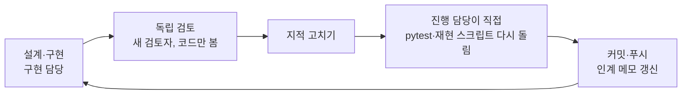

# 02. 생각의 구조와 문제 해결

> 이 문서는 머릿속을 그대로 옮긴 것이 아니다. **실제로 쓴 판단 원칙**과 **실제로 생긴 문제·해결 기록**(설계 §10, `docs/h1-review-*.md`, 커밋 기록)을 정리한 것이다.

---

## 1. 생각의 구조

### 1.1 한 단계를 끝내는 순서 (모든 단계에서 똑같이)

- **왜 검토자를 새로 부르나**: 만든 사람은 자기 실수를 못 본다. 검토자에게는 작성자 설명을 주지 않고 코드와 설계만 준다. 그래야 "작성자가 그렇다니까 맞겠지"가 끼지 않는다.
- **왜 진행 담당이 다시 돌리나**: "고쳤다"는 보고를 그대로 믿지 않는다. 시험 수, 진짜 claude 호출 수, 검토자가 문제를 재현했던 스크립트를 직접 다시 돌려 숫자로 확인한다.
- **왜 단계마다 커밋하나**: 세션이 끊겨도(실제로 컨테이너가 한 번 다시 시작됐다) 일이 사라지지 않게. 덜 된 상태면 "작업 중 스냅샷"이라고 밝히고 커밋한다.

### 1.2 판단 원칙 7가지

| # | 원칙 | 왜 | 어디에 썼나 |
|---|---|---|---|
| 1 | **결과를 보기 전에 규칙을 고정한다**(사전 등록) | 결과를 본 뒤 기준을 바꾸면 무엇이든 "통과"로 만들 수 있다 | 판정 창 63봉, 운영 기준, 재시작 상한·마감을 설계 §2.2 에 먼저 적음 |
| 2 | **기준값은 R2 다** | "새 코드가 맞다"를 판단할 바깥 기준이 필요하다 | 엔진 결과를 R2 시뮬레이터와 체결 하나하나까지 대조 |
| 3 | **운영 동작은 한 바이트도 안 바꾼다** | H1 을 넣다가 지금 돌고 있는 운영 장부가 바뀌면 안 된다 | 고치기 전에 골든 파일을 찍고, 이후 모든 변경이 골든과 같은지 시험 |
| 4 | **잘못의 종류를 나눈다** | 시세가 늦은 것(자료 문제)과 장부 계산이 틀린 것(논리 오류)을 같은 벌로 다루면 3개월을 억울하게 잃는다 | L(재시작) / D(그날만 멈춤) / W(경고) 세 등급 |
| 5 | **멈출 때는 안전하게 멈춘다** | 틀린 장부를 저장하는 것보다 그날 저장하지 않는 것이 낫다 | 오류면 그 봉 저장 안 함, 커밋 지점(HEAD), 엄격 읽기 |
| 6 | **사람이 판단할 자리를 줄인다** | 사람이 그때그때 판단하면 결과를 보고 해석이 바뀐다 | 거짓 양성(사전 등록 ④)도 프로그램이 조건을 자동 확인해 기록 |
| 7 | **사용자가 정할 일은 대신 정하지 않는다** | 위임받은 범위만 정하고 나머지는 질문으로 남긴다 | 설계 §10.1~10.2e 결정 표, §10.3 남은 질문(N1·N2) |

### 1.3 "3개월을 잃는 길"을 먼저 찾는 습관
- 이 프로젝트에서 가장 비싼 실수는 **판정 창을 처음부터 다시 시작하는 것**(63거래일 ≈ 3개월)이다.
- 그래서 검토 때마다 가장 먼저 본 질문은 둘이다.
  1. **거짓 양성**: 장부가 멀쩡한데 점검이 오류라고 하는 길이 있는가? (억울한 재시작)
  2. **거짓 통과**: 장부가 틀렸는데 점검·판정이 통과라고 하는 길이 있는가? (믿을 수 없는 결과)
- 아래 문제 목록의 대부분이 이 두 질문에서 나왔다.

---

## 2. 만들면서 생긴 문제와 해결

### 2.1 설계 단계

| 문제 | 왜 문제였나 | 해결 |
|---|---|---|
| 서킷을 끈다는 결정이 본문에 반영 안 됨(1차 X1) | 문서 안에서 "켬"과 "끔"이 섞여 결과를 보고 고를 수 있었다 | 두 장부 모두 서킷 끔. "켜져 있었다면 걸렸을 날"만 **그림자 서킷**으로 기록 |
| 시작 규칙이 점검과 충돌(1차 X2) | 시작 날 A1 현금이 그대로라 첫날부터 "현금이 남아 있음" 오류 | "S 는 입금만, S+1 시가에 전부 지수"로 한 규칙 고정, 점검에 S 예외 |
| 시세가 하루 늦으면 다음 날 장부 오류로 둔갑(1차 I1) | 자료 지연 하나로 재시작 | 보유 종목 시세가 아직 없으면 그날 멈춤(D3), 보유일수는 그날 기록한 정지 목록으로 셈 |
| **장부 지문에 실행 메모가 섞임(2차 R2-1, 치명)** | 지문에 코드 버전·실행 시각이 들어 있어, 코드를 한 글자만 고쳐도 지문이 늘 바뀜 → 사전 등록이 열어 둔 "재시작 안 해도 되는 길"이 절대 안 열림 | 실행 메모를 뺀 **장부 내용 지문**을 따로 정의 |
| 상장폐지 정리에 닿을 수 없음(2차 R2-3) | 시세를 못 받는 단계에서 먼저 멈춰 버림 | 사람이 공시로 등록하면 그 종목은 시세 점검에서 빼고, 등록한 종가로 정리 |
| 시세 "영구 정정" 길 없음(2차 R2-4) | 제공처가 지난 값을 고치면 매일 멈춤 | "정정 확정" 명령: 장부는 그대로, 비교 기준만 새 값으로 |

### 2.2 구현 2a — 골든과 작은 모듈

| 문제 | 해결 |
|---|---|
| **골든 파일 151개 중 89개가 커밋에 안 들어감**(치명). 파일이 `state/` 라는 폴더 안에 있었는데 `.gitignore` 가 `state/` 를 통째로 무시 | `.gitignore` 에 예외 `!tests/golden/**/state/`. 시험이 골든 파일 수와 git 이 무시하는 파일 0개를 직접 확인 |
| 골든이 운영 루프의 드문 경우(시세 실패·시가 없음·버려지는 주문 등) 5가지를 안 지남 | 장면을 더하고 고치기 전 코드(847ad13)에서 골든을 다시 찍음. 틀린 코드 5개를 넣어 보니 모두 잡힘 |
| 팀장 응답 글자가 깨지면 프로그램이 멈춤 | `decode_error` 로 기록하고 규칙대로 진행 |
| (진행 담당 실수) 검토 스크립트를 가짜 claude 없이 돌려 **진짜 claude 가 몇 번 불림** | 장부에는 영향 없음. 이후 "불리면 기록을 남기는 가짜 claude"를 PATH 맨 앞에 두고 모든 pytest 를 돌려 호출 0번을 매번 확인 |

### 2.3 구현 2b-1 — 엔진

| 문제 | 해결 |
|---|---|
| 한쪽 장부만 들고 있던 종목이 상장폐지되면 정상인데도 오류(거짓 양성) | 장부마다 "그때 들고 있었으면 정리, 아니면 정리 없음"을 보고, 두 장부 사이에는 날짜만 비교 |
| 주식 분할을 규칙대로 처리해도 점검이 오류 | 분할 기록 모양을 정하고, 점검이 분할 시점에 수량 ×r·매수가 ÷r 을 반영 |
| 일부 오류가 "예외로 멈춤"이라 저장하려던 장부 지문이 없음 | 오류를 목록에 모으고 끝까지 처리해 지문을 남김. 자료 문제인 경우는 L 로 세지 않음 |
| 팀장이 모르는 판정 글자("maybe")를 주면 정상으로 기록됨 | `bad_verdict` 폴백으로 세고 규칙대로 진행 |
| (확인) | R2 실데이터 6조합 대조 결과 **체결·매일 값·그림자 서킷까지 완전 일치** — 진행 담당이 직접 다시 돌려 확인 |

### 2.4 구현 2b-2 — 실행기

| 문제 | 해결 |
|---|---|
| 디스크 가득 같은 **환경 문제**가 장부 오류(재시작)로 분류 | 환경 문제는 종료 코드 4(그날만 멈춤), Ctrl-C 는 130 |
| **분할 명령을 두 번 치면 주식 수가 4배** | 시세 점검이 같은 비율의 "분할 의심"을 보고 있을 때만, 같은 기록은 한 번만 받음. `1/3`·`3:1` 같은 분수 입력 |
| 종목 시세 대부분이 실패해도 경고만 남기고 진행 | 절반 넘게 실패하면 그날 멈춤(D2) |
| 재현 통과 기록이 줄어들면 지난 봉 전체가 오류 | 통과 기록은 추가만(봉인 파일로 확인), 줄면 관문 거절 3 |
| 재시작 도중 꺼지면 사람이 직접 고쳐야 함 | "의도 줄 → 폴더 이동 → 끝 줄" 순서, 다음 재시작이 마저 끝냄 |
| 장 시작 뒤에 `start` 하면 첫날이 늦은 날이 됨 | 거절하고 "장 마감 뒤 ~ 다음 장 시작 전에" 안내 |
| 맥의 디스크 쓰기가 전원 꺼짐에 약함 | 폴더 fsync, 맥은 `F_FULLFSYNC` 까지 |

### 2.5 구현 2c — 보고서

| 문제 | 해결 |
|---|---|
| **최종 판정이 오류 일지 한 파일에만 기댐 → 그 파일 쓰기가 실패하면 잘못 "통과"** | 오류 일지 ∪ 실행 일지의 종료 코드 2 를 합쳐서 셈 |
| 실패한 시작의 오류 기록이 새 판정 창에 섞여 잘못 "실패" | 판정 창이 만들어진 시각 이후의 기록만 셈 |
| 실행이 끝 기록 없이 꺼지면 창 경계가 깨짐 | 장부에 보호된 "그 봉을 저장한 시각"으로 경계를 정함 |
| 사전 등록 ④(점검 함수 거짓 양성이면 재시작 안 함)를 기록할 방법이 없음 | 고친 코드로 다시 처리할 때 프로그램이 두 조건(장부 내용 지문 같음, 재현 지문 같음)을 자동 확인해 기록. 사람 판단 없음 |
| 같은 달 보고서가 만든 때에 따라 달라짐 | 기록을 "처리하려던 봉 날짜"로 달에 나눔 |

### 2.6 일하는 과정의 문제

| 문제 | 해결 |
|---|---|
| 컨테이너가 다시 시작되어 보고서 구현이 중간에 끊김 | 파일은 남아 있었음 → "작업 중 스냅샷"으로 커밋 → 새 구현자가 사양과 대조하며 이어서 마무리 |
| 멈춤 훅이 "커밋 안 된 변경"을 막음 | 검토·수정 중에도 문서·코드를 스냅샷으로 커밋하고 이유를 커밋 메시지에 적음 |
| 검토 스크립트가 낡은 컴파일 파일(`__pycache__`)을 남김 | 돌연변이 시험 뒤 낡은 pyc 를 지우고 다시 돌림 |

---

## 3. 숫자로 본 과정

| 단계 | 독립 검토 지적(치명·중요·경미) | 시험 수(끝날 때) |
|---|---|---:|
| 설계 1차 | 2 · 11 · 9 | 306(기존) |
| 설계 2차 | 1 · 3 · 13 | 306 |
| 2a 골든·작은 모듈 | 1 · 1 · 9 | 395 |
| 2b-1 엔진 | 0 · 3 · 7 | 562 |
| 2b-2 실행기 | 0 · 5 · 13 | 682 |
| 2c 보고서 | 0 · 4 · 5 | 755 |

- 치명 지적이 설계·초기 단계에서 나오고 뒤로 갈수록 줄었다. 앞 단계 검토가 뒤 단계의 큰 실수를 막았다.
- 지적은 모두 고쳤고, 고친 것마다 시험을 붙였다(같은 실수가 다시 나오면 시험이 실패).

## 4. 남은 위험 (아직 확인 못 한 것)

- 맥 실제 환경: 미국 일봉이 나중에 자주 고쳐져 D6(소급 수정)이 자주 나는지, KS200 캐시 갱신 시각, 파이썬 자동 업그레이드로 환경이 바뀌는지. → 단계 7 체크리스트.
- 재현(단계 5)을 아직 안 돌렸다. 엔진은 R2 와 실데이터로 맞췄지만, 실행기 전체(start→run 매일·저장·읽기)를 R2 와 맞추는 것은 단계 5 몫이다.
